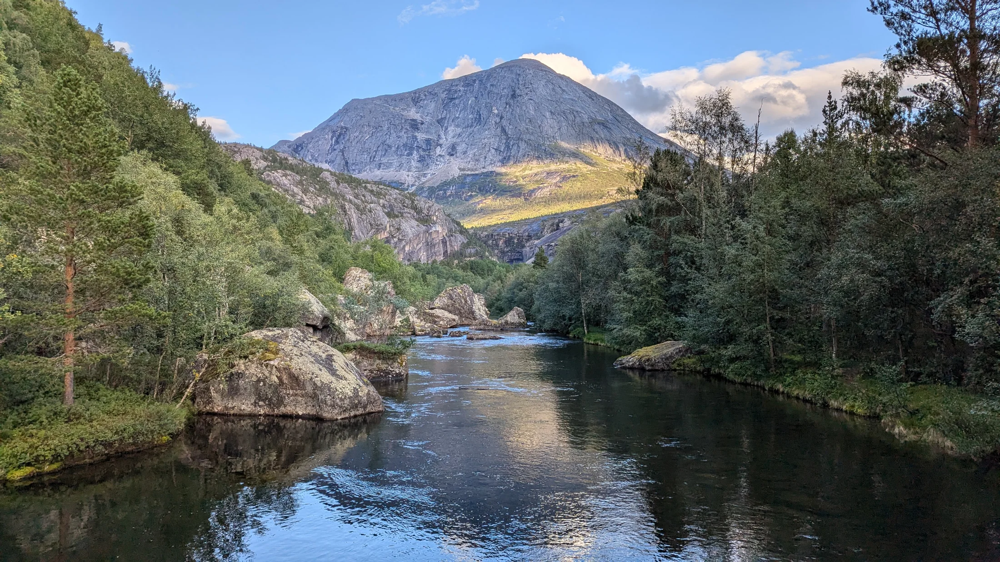

::: {.hero}
::: {.hero-copy}

Environmental Stress Systems Ecology

## ¿Cómo afrontan los sistemas vivos el estrés ambiental?

La contaminación, el aumento de la salinidad y otras presiones ambientales afectan a los sistemas vivos de distintas maneras. Los organismos responden ajustando sus procesos moleculares, su fisiología y sus interacciones con el ambiente. Estos cambios pueden influir en su funcionamiento, su salud y su capacidad de recuperarse de las perturbaciones.

Mi investigación explora cómo trabajan conjuntamente los procesos biológicos bajo estrés ambiental, cómo cambia su organización y qué implican estos cambios para la resiliencia.

Combino estudios de campo, biología molecular y enfoques computacionales. Mi experiencia con organismos y ecosistemas acuáticos me permite investigar preguntas que abarcan distintas escalas biológicas.

[Explorar la investigación](research.qmd){.btn .btn-primary}
[CV académico](https://camiloescobarsierra.com/miloes114-academic-cv/Camilo_Escobar_Sierra_Academic_CV.pdf){.btn .btn-outline-secondary}
:::

::: {.hero-side}
### Posición actual

**Investigador posdoctoral y docente** 
Institute for Environmental Research (IfER), RWTH Aachen University
:::
:::

::: {.home-landscape}
{fig-alt="Río de montaña rodeado de bosque bajo un pico rocoso."}

Explorando y pescando en ríos árticos de Noruega.

:::

---

## Cómo estudio el estrés ambiental

Mi trabajo conecta estudios de campo, respuestas biológicas y distintas fuentes de evidencia para comprenderlas.

::: {.research-grid}
::: {.research-card}
### Estrés ambiental en el campo

Estudio cómo la contaminación, la salinidad y otras presiones ambientales afectan a los sistemas acuáticos mediante estudios de campo y experimentos que reflejan condiciones de exposición naturales.

[Leer más →](research.qmd#real-world-environmental-stress)
:::

::: {.research-card}
### Cómo responden los sistemas biológicos

Investigo cómo se ajustan los procesos biológicos ante el estrés, cómo estas respuestas ayudan a mantener funciones esenciales y cómo cambia su eficacia cuando aumentan las presiones ambientales.

[Leer más →](research.qmd#biological-organisation-and-resilience)
:::

::: {.research-card}
### Conectar la evidencia molecular y ecológica

Integro información molecular, microbiana, fisiológica y ecológica para comprender cómo se coordinan los procesos biológicos y cómo influye esta organización en la salud y la resiliencia.

[Leer más →](research.qmd#integrative-eco-omics)
:::
:::

::: {.cross-cutting}
También desarrollo herramientas de análisis reproducibles que facilitan la interpretación, la comparación y la reutilización de datos moleculares, especialmente en especies poco estudiadas.
:::

::: {.research-programme-map role="group" aria-labelledby="research-programme-title-es"}
### Explorar el estrés ambiental a distintas escalas biológicas {#research-programme-title-es}

Estos aspectos de mi investigación ayudan a comprender cómo afectan las presiones ambientales a los sistemas vivos. Sus relaciones pueden variar entre distintos sistemas.

<ul class="programme-map" aria-label="Aspectos relacionados de la investigación sobre estrés ambiental">
  <li><strong>Presiones ambientales</strong>Estudios de campo · exposición</li>
  <li><strong>Respuestas biológicas</strong>Genes · microbios · fisiología</li>
  <li><strong>Cómo se coordinan los procesos</strong>Organización biológica</li>
  <li><strong>Salud y función</strong>Condición · desempeño</li>
  <li><strong>Resiliencia y cambio ecológico</strong>Persistencia · recuperación</li>
</ul>

La organización biológica describe cómo interactúan y coordinan sus actividades los componentes y procesos de los sistemas vivos.
:::

---

## Trabajos seleccionados

::: {.project-strip}
::: {.project-mini}
**EchoGO**  
Una herramienta de código abierto que ayuda a interpretar cambios en la actividad de los genes, especialmente en especies poco estudiadas.

[MethodsX](https://doi.org/10.1016/j.mex.2026.104222) · [GitHub](https://github.com/miloes114/EchoGo) · [Zenodo](https://doi.org/10.5281/zenodo.17658714)
:::

::: {.project-mini}
**Holtemme Gammarus Ecotoxicogenomics**  
Un análisis reproducible que relaciona mezclas de contaminantes en un río con cambios en la actividad génica y las redes biológicas del anfípodo de agua dulce *Gammarus pulex*.

[GitHub](https://github.com/miloes114/holtemme-gammarus-ecotoxicogenomics)
:::

::: {.project-mini}
**Organización biológica y resiliencia**  
Investigaciones en curso sobre cómo los sistemas vivos coordinan sus respuestas al estrés ambiental y mantienen funciones esenciales.

[Programa de investigación](research.qmd#biological-organisation-and-resilience)
:::
:::

---

## Una trayectoria arraigada en los organismos y la ecología de campo

Mi investigación comenzó con estudios de campo sobre peces y ecosistemas de agua dulce en Colombia. Después me centré en cómo responden la fisiología y la actividad génica de los peces al estrés ambiental. Hoy combino observaciones de campo, evidencia molecular y enfoques computacionales para investigar la organización biológica y la resiliencia.

[Sobre mí](about.qmd) · [Publicaciones seleccionadas](publications.qmd)

---

## Seguir la investigación

Comparto avances de proyectos, actividad en congresos y trabajo en curso a través de mis perfiles profesionales.

[LinkedIn](https://www.linkedin.com/in/camilo-escobar-sierra-a17973116/) · [GitHub](https://github.com/miloes114) · [CV académico](https://camiloescobarsierra.com/miloes114-academic-cv/Camilo_Escobar_Sierra_Academic_CV.pdf)
