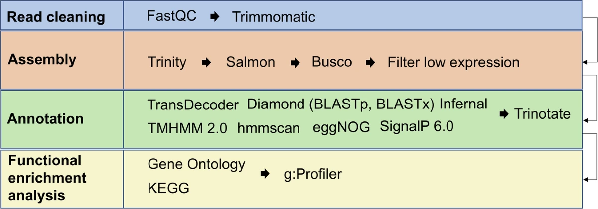
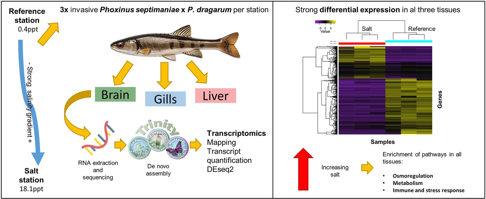
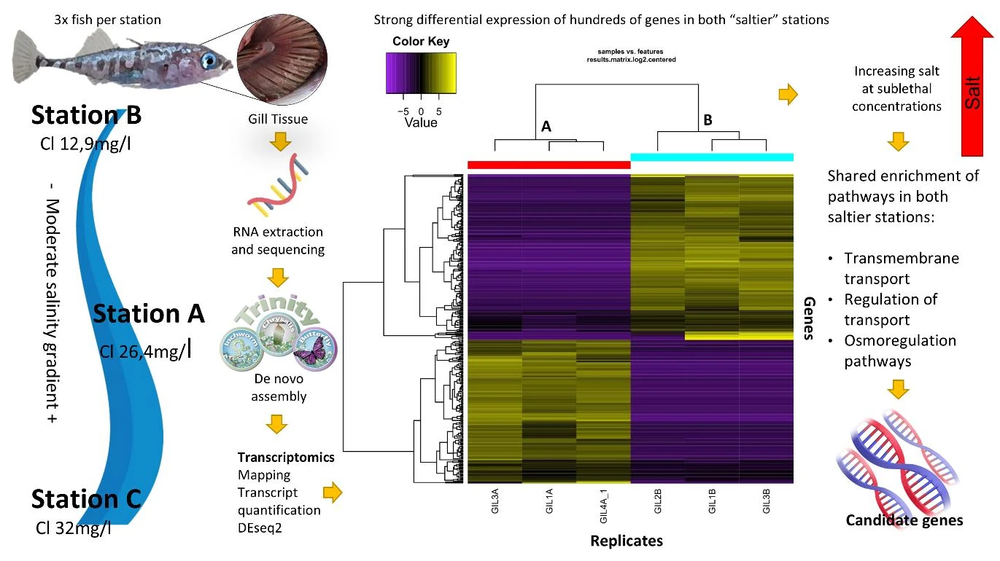
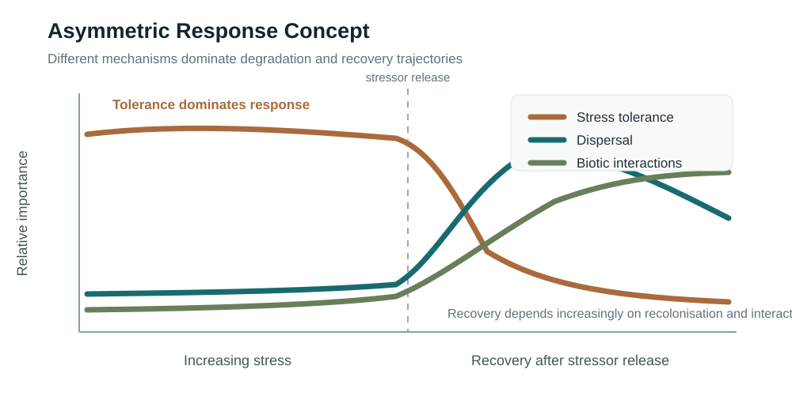
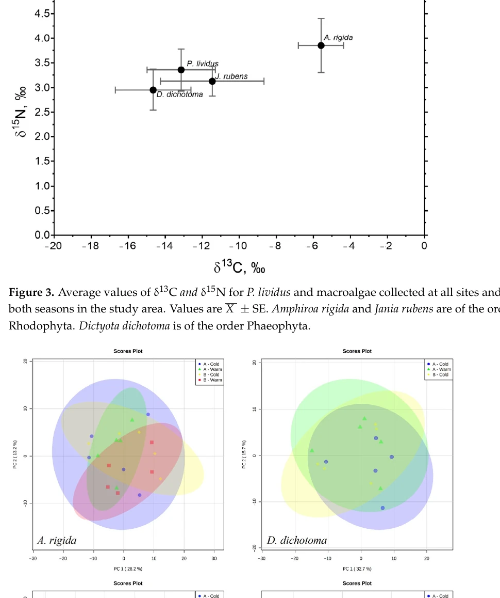
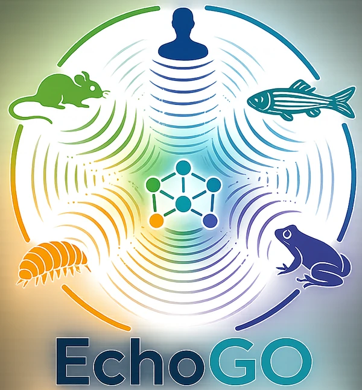

Estos trabajos muestran cómo la ecología de campo, la biología del estrés ambiental y los enfoques moleculares han ido convergiendo hacia preguntas sobre organización biológica y resiliencia.

## Publicaciones seleccionadas revisadas por pares

::: {.publication-showcase}

Recurso de ecotoxicogenómica para un organismo no modelo

### De novo transcriptome assembly and annotation of the common freshwater amphipod (*Gammarus pulex*): a valuable resource for ecotoxicogenomics

<strong>Escobar-Sierra, C.</strong>, Hassan, S., Weichert, F. G., Aronsson, H., Lampert, K. P., Hollert, H., Backhaus, T., & Inostroza, P. A. (2025). <em>Scientific Data</em>, 12, 1502.

::: {.publication-visual}
{fig-alt="Flujo de trabajo que resume el procesamiento de lecturas crudas, el ensamblaje de novo del transcriptoma, la validación y la anotación del recurso transcriptómico de Gammarus pulex."}
:::

Visual del estudio: Fig. 2 de Escobar-Sierra et al. (2025), CC BY 4.0.

<strong>Por qué es relevante.</strong> Un recurso molecular abierto diseñado para facilitar ecotoxicogenómica reproducible en un organismo centinela de agua dulce ampliamente utilizado y no modelo.

[DOI →](https://doi.org/10.1038/s41597-025-05872-2)

:::

::: {.publication-showcase}

Transcriptómica comparativa multitejido en peces

### Unraveling the molecular mechanisms of fish physiological response to freshwater salinization: A comparative multi-tissue transcriptomic study in a river polluted by potash mining

<strong>Escobar-Sierra, C.</strong>, Cañedo-Argüelles, M., Vinyoles, D., & Lampert, K. P. (2024). <em>Environmental Pollution</em>, 357, 124400.

::: {.publication-visual}
{fig-alt="Resumen gráfico que sintetiza las respuestas transcriptómicas comparativas multitejido de peces frente a la salinización del agua dulce."}
:::

Visual del estudio: resumen gráfico de Escobar-Sierra et al. (2024), CC BY-NC.

<strong>Por qué es relevante.</strong> Conectó una exposición ambientalmente realista con mecanismos de respuesta molecular específicos y compartidos entre cerebro, branquias e hígado.

[DOI →](https://doi.org/10.1016/j.envpol.2024.124400)

:::

::: {.publication-showcase}

Transcriptómica *de novo* aplicada en campo

### Field application of de novo transcriptomic analysis to evaluate the effects of sublethal freshwater salinization on *Gasterosteus aculeatus* in urban streams

<strong>Escobar-Sierra, C.</strong> & Lampert, K. P. (2024). <em>PLOS ONE</em>, 19, e0298213.

::: {.publication-visual}
{fig-alt="Resumen gráfico que sintetiza la aplicación en campo de la transcriptómica de novo para evaluar la salinización subletal del agua dulce en peces silvestres."}
:::

Visual del estudio: resumen gráfico de la [tesis doctoral](https://kups.ub.uni-koeln.de/75069/), capítulo 1, CC BY-NC.

<strong>Por qué es relevante.</strong> Mostró cómo la transcriptómica *de novo* puede recuperar respuestas mecanísticas subletales directamente en peces silvestres bajo condiciones de campo complejas.

[DOI →](https://doi.org/10.1371/journal.pone.0298213)

:::

::: {.publication-showcase}

Teoría de estresores múltiples

### The Asymmetric Response Concept explains ecological consequences of multiple stressor exposure and release

Vos, M., Hering, D., Gessner, M. O., et al., <strong>Escobar-Sierra, C.</strong>, et al. (2023). <em>Science of the Total Environment</em>, 872, 162196.

::: {.publication-visual .publication-visual--schematic}
{fig-alt="Esquema original del Concepto de Respuesta Asimétrica que muestra distintos impulsores ecológicos durante el aumento y la liberación de estresores."}
:::

Visual del estudio: esquema original del sitio web basado en el concepto desarrollado en Vos et al. (2023).

<strong>Por qué es relevante.</strong> Contribuyó a un marco conceptual más amplio para entender por qué la respuesta ecológica al aumento y a la liberación de estresores no tiene que seguir la misma trayectoria.

[DOI →](https://doi.org/10.1016/j.scitotenv.2023.162196)

:::

::: {.publication-showcase}

Ecología y ómicas

### Metabolomics unravels grazing interactions under nutrient enrichment from aquaculture

<strong>Escobar-Sierra, C.</strong>, de Kock, W., Hasler-Sheetal, H., Holmer, M., Chatzigeorgiou, G., Tsapakis, M., & Apostolaki, E. T. (2023). <em>Diversity</em>, 15, 31.

::: {.publication-visual}
{fig-alt="Figura clave que muestra patrones metabólicos asociados al enriquecimiento de nutrientes por acuicultura y a las interacciones de pastoreo."}
:::

Visual del estudio: Fig. 5 de Escobar-Sierra et al. (2023), CC BY 4.0.

<strong>Por qué es relevante.</strong> Una integración temprana entre experimentación ecológica y un enfoque ómico, conectando el enriquecimiento de nutrientes asociado a la acuicultura con respuestas metabólicas a nivel de comunidad.

[DOI →](https://doi.org/10.3390/d15010031)

:::

## Software

### EchoGO

::: {.software-showcase}
{fig-alt="Logo de EchoGO." .software-logo}

**Escobar-Sierra, C.**, Langschied, F., Miller, A., & Inostroza, P. A.  
Marco abierto en R para la interpretación funcional sensible al contexto de anotación en eco-ómicas de organismos no modelo.

[GitHub](https://github.com/miloes114/EchoGo) · [Última versión v0.1.4](https://github.com/miloes114/EchoGo/releases/tag/v0.1.4) · [Zenodo v0.1.4](https://doi.org/10.5281/zenodo.23158481)
:::

## Recursos de datos

### Recurso transcriptómico de *Gammarus pulex*

Un recurso molecular abierto descrito en el artículo de *Scientific Data* anterior. El DOI del artículo es el punto de entrada estable a la información sobre disponibilidad de los datos.

[DOI](https://doi.org/10.1038/s41597-025-05872-2)

## Compendios de investigación

### Compendio de ecotoxicogenómica de *Gammarus* en el Holtemme

Un compendio de investigación reproducible y versionado que integra química ambiental, RNA-seq, interpretación funcional y análisis de redes.

[GitHub](https://github.com/miloes114/holtemme-gammarus-ecotoxicogenomics)

---

## Registro completo de publicaciones

Para consultar la lista completa:

[Google Scholar](https://scholar.google.com/citations?user=MZuNEEoAAAAJ&hl=en) · [ORCID](https://orcid.org/0000-0001-9105-4378) · [ResearchGate](https://www.researchgate.net/profile/Camilo-Escobar-Sierra) · [CV académico](https://camiloescobarsierra.com/miloes114-academic-cv/Camilo_Escobar_Sierra_Academic_CV.pdf)
