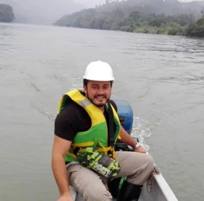
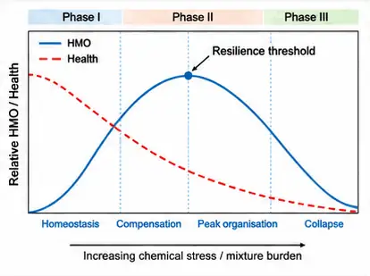

## Environmental Stress Systems Ecology

Los sistemas vivos mantienen sus funciones mediante interacciones entre componentes biológicos, desde redes moleculares y procesos celulares hasta organismos, comunidades y ecosistemas. El estrés ambiental puede modificar estas interacciones y los recursos necesarios para sostenerlas.

Mi investigación estudia **cómo cambia la organización biológica a lo largo de gradientes de estrés ambiental**, cómo estos cambios influyen en el funcionamiento de los sistemas y en qué condiciones contribuyen a su resiliencia o deterioro. Combino ecología molecular, ecotoxicología ambiental, biología de sistemas y enfoques computacionales. Los ambientes acuáticos proporcionan gran parte de la base empírica de mi trabajo, mientras que las preguntas centrales abarcan distintos sistemas y escalas biológicas.

**Mi pregunta central:** ¿Cómo modifica el estrés ambiental la organización biológica a distintas escalas y cómo influyen estos cambios en el funcionamiento y la resiliencia de los sistemas vivos?

::: {.photo-strip .research-photo-strip}
::: {.photo-strip-item .photo-strip-item--boat}
{fig-alt="Trabajo de campo en un río desde una embarcación pequeña."}

Evaluación de biodiversidad en el río Cauca, Colombia.

:::

::: {.photo-strip-item .photo-strip-item--stream}
{fig-alt="Muestreo con red en un sistema acuático urbano."}

Pesca eléctrica durante una evaluación de biodiversidad en ríos urbanos del Caribe colombiano.

:::

::: {.photo-strip-item .photo-strip-item--reef}
{fig-alt="Buceo sobre un arrecife de coral."}

Explorando arrecifes de coral en Egipto.

:::
:::

## Estrés ambiental y sistemas vivos {#real-world-environmental-stress}

Los ambientes naturales exponen a los sistemas biológicos a condiciones cambiantes, entre ellas mezclas químicas, salinización, variaciones de temperatura y otras presiones que interactúan en el espacio y el tiempo. Los ríos y ecosistemas costeros permiten estudiar estas presiones en condiciones realistas.

Mi trabajo con peces silvestres y anfípodos de agua dulce ha relacionado gradientes ambientales con cambios en la actividad de los genes y en procesos biológicos. La transcriptómica de campo, las comparaciones entre tejidos y la química ambiental permiten explorar cómo varían las respuestas entre organismos, tejidos y localidades. Estas observaciones ayudan a formular hipótesis sobre los procesos que sostienen el funcionamiento de los sistemas biológicos bajo estrés.

## Organización biológica y resiliencia {#biological-organisation-and-resilience}

La organización biológica describe **cómo se conectan, coordinan y estructuran los componentes de un sistema vivo**. Desde una perspectiva termodinámica, mantener estados organizados requiere intercambios continuos de energía y materia. Desde la teoría de redes, podemos estudiar la organización mediante patrones de conectividad, modularidad, redundancia y coordinación entre componentes. Estas perspectivas complementarias ayudan a comprender cómo los sistemas vivos mantienen y reorganizan sus funciones.

Organización, función y resiliencia describen aspectos relacionados de este proceso:

- **Organización:** la estructura y coordinación de componentes y procesos biológicos.
- **Función:** las actividades y el desempeño que sostiene el sistema.
- **Resiliencia:** su capacidad para mantener o recuperar funciones esenciales ante perturbaciones.

### La hipótesis jerárquica del gradiente de estrés (Hi-SGH)

Estoy desarrollando **Hi-SGH** como un marco comprobable para investigar cómo responde la organización biológica al estrés ambiental. La hipótesis propone que las respuestas compensatorias pueden aumentar inicialmente la coordinación entre procesos. A medida que aumenta la presión, mantener esa organización podría resultar cada vez más exigente y vulnerable, hasta dar paso a una reducción de la coordinación y al deterioro funcional.

Hi-SGH se apoya en la teoría ecológica del estrés, las perspectivas termodinámicas sobre los sistemas vivos y la teoría de redes. Plantea predicciones sobre cambios en la organización, la compensación y posibles umbrales que pueden ponerse a prueba en distintos sistemas biológicos.

<figure class="research-concept-figure research-concept-figure--curve">
  <video class="research-animation" autoplay muted loop playsinline preload="metadata" poster="../assets/images/research/hi-sgh-stress-gradient-still.webp" aria-label="Animación conceptual de Hi-SGH sobre organización biológica y salud a lo largo de un gradiente creciente de estrés químico.">
    <source src="../assets/images/research/hi-sgh-stress-gradient.mp4" type="video/mp4">
  </video>
  
  <figcaption><strong>Hi-SGH: predicciones conceptuales.</strong> La animación ilustra una posible trayectoria a lo largo de un gradiente creciente de estrés químico. En TROPECO-OMICS, la <em>organización multicapa del holobionte</em> (HMO, azul) describe la coordinación entre capas transcriptómicas, proteómicas, microbianas y fisiológicas; la salud (rojo) se evalúa de manera independiente. Las curvas son hipótesis para poner a prueba, sin representar trayectorias observadas ni umbrales universales.</figcaption>
</figure>

## Medición de la organización biológica {#integrative-eco-omics}

Para abordar estas preguntas, integro mediciones de expresión génica, proteínas, comunidades microbianas y condición fisiológica con química ambiental e información ecológica. **El análisis de redes y las eco-ómicas integrativas** permiten cuantificar cómo se relacionan los procesos biológicos, qué conexiones cambian y cómo varía su coordinación a lo largo de gradientes ambientales.

Un pez y sus microorganismos asociados constituyen un ejemplo de **holobionte**: componentes del hospedador y de sus comunidades microbianas que interactúan y pueden estudiarse conjuntamente. La misma lógica de investigación puede aplicarse a otros organismos, comunidades biológicas y redes ecológicas.

<figure class="research-concept-figure research-concept-figure--fish">
  <video class="research-animation" autoplay muted loop playsinline preload="metadata" poster="../assets/images/research/reef-fish-holobiont-still.webp" aria-label="Animación de un pez de arrecife que ilustra las interacciones entre ARN, proteínas y microbioma en torno al hospedador.">
    <source src="../assets/images/research/reef-fish-holobiont.mp4" type="video/mp4">
  </video>
  
  <figcaption><strong>Un sistema biológico integrado.</strong> Un pez de arrecife ilustra cómo pueden estudiarse conjuntamente los procesos moleculares y los microorganismos asociados al hospedador. Los patrones cambiantes de redes son conceptuales y representan posibles formas de reorganización biológica.</figcaption>
</figure>

En **TROPECO-OMICS**, propongo medir la organización multicapa del holobionte (HMO) mediante propiedades de las redes dentro de cada capa y la concordancia entre datos moleculares, microbianos y fisiológicos. La condición del sistema se evalúa por separado mediante indicadores de salud y desempeño. Las métricas de redes permiten cuantificar aspectos de la organización y complementan las ideas termodinámicas que motivan el programa más amplio.

## De la teoría a la evidencia ecológica

Mi trayectoria ha evolucionado desde **la ecología de campo y la evaluación de biodiversidad acuática** hacia la fisiología del estrés en peces, la transcriptómica y la bioinformática ambiental. Los estudios sobre salinización del agua dulce y mezclas complejas de contaminantes proporcionaron la base empírica para investigar cómo se organizan las respuestas ambientales. La investigación con *Gammarus pulex* ha ampliado estas preguntas a invertebrados de agua dulce y gradientes de química ambiental.

Desarrollo recursos computacionales reproducibles que conservan el vínculo entre los resultados moleculares y su interpretación biológica. [EchoGO](https://github.com/miloes114/EchoGo), presentado en [*MethodsX*](https://doi.org/10.1016/j.mex.2026.104222), facilita la interpretación funcional trazable de datos transcriptómicos, especialmente en organismos no modelo.

**TROPECO-OMICS** ofrece una aplicación propuesta de Hi-SGH a holobiontes de peces tropicales de agua dulce mediante la integración de exposición química, redes moleculares y microbianas, variables fisiológicas y evaluaciones independientes de salud. Mis intereses también abarcan los sistemas costeros, incluidos los organismos de arrecife y los efectos del cambio ambiental sobre la biodiversidad y el funcionamiento de los ecosistemas.

El objetivo a largo plazo de **Environmental Stress Systems Ecology** es desarrollar y poner a prueba enfoques transferibles que relacionen la exposición ambiental, la organización biológica, el funcionamiento de los sistemas y la resiliencia ecológica.

[Explorar proyectos](projects.qmd) · [Publicaciones seleccionadas](publications.qmd) · [CV académico](https://camiloescobarsierra.com/miloes114-academic-cv/Camilo_Escobar_Sierra_Academic_CV.pdf)
