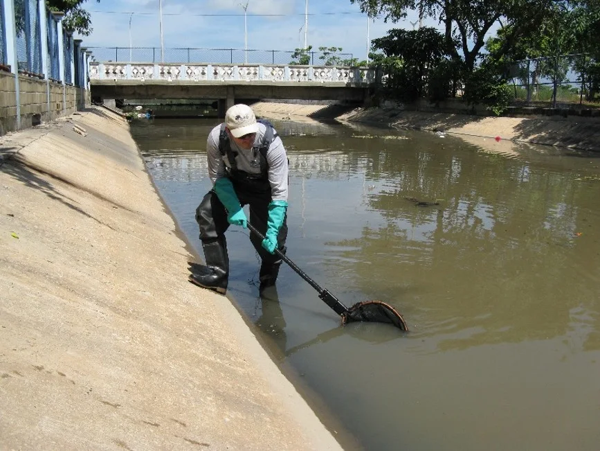
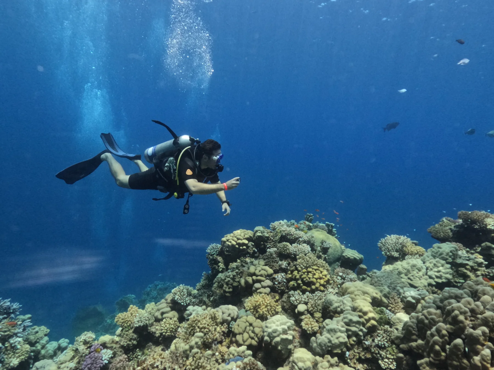
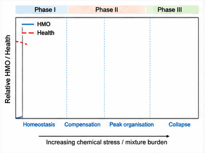
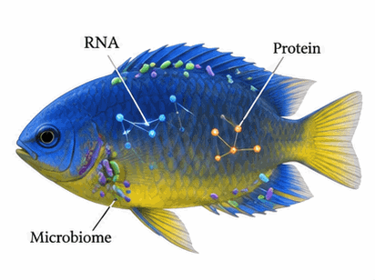
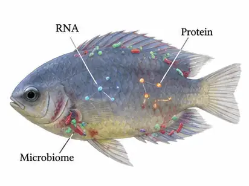

## Environmental Stress Systems Ecology

Los sistemas vivos mantienen sus funciones mediante interacciones entre componentes biológicos, desde redes moleculares y procesos celulares hasta organismos, comunidades y ecosistemas. El estrés ambiental puede modificar estas interacciones y los recursos necesarios para sostenerlas.

Mi investigación estudia **cómo cambia la organización biológica a lo largo de gradientes de estrés ambiental**, cómo estos cambios influyen en el funcionamiento de los sistemas y en qué condiciones contribuyen a su resiliencia o deterioro. Combino ecología molecular, ecotoxicología ambiental, biología de sistemas y enfoques computacionales. Los ambientes acuáticos proporcionan gran parte de la base empírica de mi trabajo, mientras que las preguntas centrales abarcan distintos sistemas y escalas biológicas.

**Mi pregunta central:** ¿Cómo modifica el estrés ambiental la organización biológica a distintas escalas y cómo influyen estos cambios en el funcionamiento y la resiliencia de los sistemas vivos?

::: {.photo-strip .research-photo-strip}
::: {.photo-strip-item .photo-strip-item--boat}
{fig-alt="Trabajo de campo en un río desde una embarcación pequeña."}

Evaluación de biodiversidad en el río Cauca, Colombia.

:::

::: {.photo-strip-item .photo-strip-item--stream}
{fig-alt="Muestreo con red en un sistema acuático urbano."}

Pesca eléctrica durante una evaluación de biodiversidad en ríos urbanos del Caribe colombiano.

:::

::: {.photo-strip-item .photo-strip-item--reef}
{fig-alt="Buceo sobre un arrecife de coral."}

Explorando arrecifes de coral en Egipto.

:::
:::

## Estrés ambiental y sistemas vivos {#real-world-environmental-stress}

Los ambientes naturales exponen a los sistemas biológicos a condiciones cambiantes, entre ellas mezclas químicas, salinización, variaciones de temperatura y otras presiones que interactúan en el espacio y el tiempo. Los ríos y ecosistemas costeros permiten estudiar estas presiones en condiciones realistas.

Mi trabajo con peces silvestres y anfípodos de agua dulce ha relacionado gradientes ambientales con cambios en la actividad de los genes y en procesos biológicos. La transcriptómica de campo, las comparaciones entre tejidos y la química ambiental permiten explorar cómo varían las respuestas entre organismos, tejidos y localidades. Estas observaciones ayudan a formular hipótesis sobre los procesos que sostienen el funcionamiento de los sistemas biológicos bajo estrés.

## Organización biológica y resiliencia {#biological-organisation-and-resilience}

La organización biológica describe **cómo se conectan, coordinan y estructuran los componentes de un sistema vivo**. Desde una perspectiva termodinámica, mantener estados organizados requiere intercambios continuos de energía y materia. Desde la teoría de redes, podemos estudiar la organización mediante patrones de conectividad, modularidad, redundancia y coordinación entre componentes. Estas perspectivas complementarias ayudan a comprender cómo los sistemas vivos mantienen y reorganizan sus funciones.

Organización, función y resiliencia describen aspectos relacionados de este proceso:

- **Organización:** la estructura y coordinación de componentes y procesos biológicos.
- **Función:** las actividades y el desempeño que sostiene el sistema.
- **Resiliencia:** su capacidad para mantener o recuperar funciones esenciales ante perturbaciones.

### La hipótesis jerárquica del gradiente de estrés (Hi-SGH)

Estoy desarrollando **Hi-SGH** como un marco comprobable dentro de este programa de investigación. La hipótesis propone que las respuestas compensatorias pueden aumentar inicialmente la coordinación entre procesos biológicos. A medida que aumenta la presión, mantener esa coordinación puede exigir más recursos y llegar a ser menos eficaz, con consecuencias para el funcionamiento y la resiliencia del sistema.

Hi-SGH se apoya en la teoría ecológica del estrés, las perspectivas termodinámicas sobre los sistemas vivos y la teoría de redes. Plantea predicciones sobre cambios en la organización, la compensación y posibles umbrales que pueden ponerse a prueba en distintos sistemas biológicos.

<figure class="research-concept-figure research-concept-figure--curve">
  
  
  <button type="button" class="research-motion-toggle" data-play-label="Reproducir animación" data-pause-label="Pausar animación" hidden>Pausar animación</button>
  <figcaption><strong>Hi-SGH: predicciones conceptuales.</strong> La curva azul HMO (organización multicapa del holobionte) ilustra una posible medida cuantitativa de coordinación biológica, inspirada en la teoría de redes y en perspectivas termodinámicas sobre los sistemas vivos. La curva roja representa la salud como una dimensión independiente. Sus formas y posibles puntos de transición son hipótesis que se pueden evaluar en distintos sistemas biológicos.</figcaption>
</figure>

## Medición de la organización biológica {#integrative-eco-omics}

Para abordar estas preguntas, integro datos de expresión génica, mediciones de proteínas, comunidades microbianas y fisiología con química ambiental e información ecológica. **El análisis de redes y las eco-ómicas integrativas** ayudan a identificar qué procesos actúan de forma coordinada, cómo cambian sus relaciones a lo largo de gradientes ambientales y cómo se vinculan estos cambios con la condición del sistema. A otras escalas, se pueden explorar preguntas comparables mediante redes de interacción ecológica y de comunidades.

Un pez y sus microorganismos asociados constituyen un ejemplo de **holobionte**: componentes del hospedador y de sus comunidades microbianas que interactúan y pueden estudiarse conjuntamente. La misma lógica de investigación puede aplicarse a otros organismos, comunidades biológicas y redes ecológicas.

<figure class="research-concept-figure research-concept-figure--fish">
  
  
  <button type="button" class="research-motion-toggle" data-play-label="Reproducir animación" data-pause-label="Pausar animación" hidden>Pausar animación</button>
  <figcaption><strong>Un sistema biológico integrado.</strong> Este pez de arrecife ejemplifica cómo pueden estudiarse conjuntamente los procesos moleculares y los microorganismos asociados al hospedador. Las redes animadas muestran posibles patrones de organización; las preguntas del programa también abarcan comunidades y ecosistemas.</figcaption>
</figure>

En mi programa de investigación desarrollo formas de cuantificar la organización mediante conectividad, modularidad, redundancia y coordinación dentro de los procesos biológicos y entre ellos. Estas métricas permiten estudiar patrones propuestos desde la teoría de redes, mientras que las perspectivas termodinámicas ayudan a comprender cómo los sistemas vivos mantienen estados organizados mediante intercambios de energía y materia. Las medidas independientes de condición fisiológica, desempeño y funcionamiento ecológico permiten relacionar estos patrones con la salud y la resiliencia.

## De la teoría a la evidencia ecológica

Mi trayectoria ha evolucionado desde **la ecología de campo y la evaluación de biodiversidad acuática** hacia la fisiología del estrés en peces, la transcriptómica y la bioinformática ambiental. Los estudios sobre salinización del agua dulce y mezclas complejas de contaminantes proporcionaron la base empírica para investigar cómo se organizan las respuestas ambientales. La investigación con *Gammarus pulex* ha ampliado estas preguntas a invertebrados de agua dulce y gradientes de química ambiental.

Desarrollo recursos computacionales reproducibles que conservan el vínculo entre los resultados moleculares y su interpretación biológica. [EchoGO](https://github.com/miloes114/EchoGo), presentado en [*MethodsX*](https://doi.org/10.1016/j.mex.2026.104222), facilita la interpretación funcional trazable de datos transcriptómicos, especialmente en organismos no modelo.

Este programa ya se desarrolla mediante mis estudios publicados, análisis en curso sobre respuestas al estrés ambiental, herramientas computacionales reproducibles y propuestas de investigación interdisciplinaria. Estas actividades conectan observaciones de campo con enfoques cuantitativos sobre organización biológica y condición de los sistemas. Estoy ampliando estas preguntas a ambientes de agua dulce y marinos, incluidos sistemas acuáticos tropicales y de arrecife, para estudiar cómo varían los principios generales según el contexto ecológico y la escala biológica.

El objetivo a largo plazo de **Environmental Stress Systems Ecology** es desarrollar y poner a prueba enfoques transferibles que relacionen la exposición ambiental, la organización biológica, el funcionamiento de los sistemas y la resiliencia ecológica.

[Explorar proyectos](projects.qmd) · [Publicaciones seleccionadas](publications.qmd) · [CV académico](https://camiloescobarsierra.com/miloes114-academic-cv/Camilo_Escobar_Sierra_Academic_CV.pdf)

