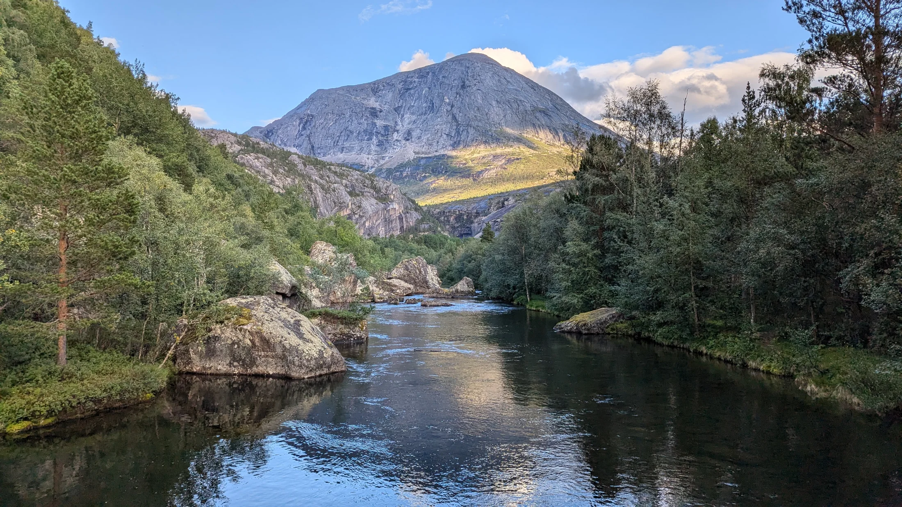

::: {.hero}
::: {.hero-copy}

Environmental Stress Systems Ecology

## Understanding biological organisation and resilience under environmental stress

Living systems sustain their functions through interactions among biological components. I study how environmental stress changes that organisation, and what these changes mean for system function and resilience.

My approach brings together field ecology, molecular biology and computational methods. Aquatic organisms, communities and ecosystems provide a strong empirical foundation for questions that extend across biological scales.

[Explore the research](research.qmd){.btn .btn-primary}
[Academic CV](https://camiloescobarsierra.com/miloes114-academic-cv/Camilo_Escobar_Sierra_Academic_CV.pdf){.btn .btn-outline-secondary}
:::

::: {.hero-side}
### Current position

**Postdoctoral Researcher & Lecturer** 
Institute for Environmental Research (IfER), RWTH Aachen University
:::
:::

::: {.home-landscape}
{fig-alt="Forested mountain river beneath a rocky peak."}

Exploring and fishing Arctic rivers in Norway.

:::

---

## Three connected research dimensions

Together, these dimensions frame my research programme.

::: {.research-grid}
::: {.research-card}
### Real-world environmental stress

Field gradients reveal how chemical mixtures, salinisation and changing environmental conditions affect living systems in their ecological context.

[Read more →](research.qmd#real-world-environmental-stress)
:::

::: {.research-card}
### Biological organisation and resilience

I study how stress changes the organisation of biological processes, how compensation is maintained, and what these changes mean for function and resilience.

[Read more →](research.qmd#biological-organisation-and-resilience)
:::

::: {.research-card}
### Measuring biological organisation

I bring together molecular, microbial, physiological and ecological evidence with network analysis to examine how biological components are connected and coordinated.

[Read more →](research.qmd#integrative-eco-omics)
:::
:::

::: {.cross-cutting}
Across these questions, I develop reproducible workflows and resources for complex and non-model biological systems, with emphasis on traceability, biological interpretation and reusable computation.
:::

::: {.research-programme-map role="group" aria-labelledby="research-programme-title"}
### A conceptual map of the research programme {#research-programme-title}

The map follows how I connect environmental gradients with biological responses, cross-layer organisation, resilience and ecological consequences.

<ol class="programme-map" aria-label="Conceptual organisation of the research programme">
  <li><strong>Environmental stressors &amp; gradients</strong>Field ecology · environmental chemistry</li>
  <li><strong>Molecular, microbial &amp; physiological responses</strong>Transcriptomics · microbiome · physiology</li>
  <li><strong>Cross-layer biological organisation</strong>Multi-omics · networks · coordination</li>
  <li><strong>Compensation &amp; resilience</strong>Buffering · thresholds · performance</li>
  <li><strong>Ecological consequences</strong>Organismal condition · ecological interpretation</li>
</ol>
:::

---

## Selected work

::: {.project-strip}
::: {.project-mini}
**EchoGO**  
A reproducible framework for annotation-context-aware functional interpretation in non-model transcriptomics.

[MethodsX](https://doi.org/10.1016/j.mex.2026.104222) · [GitHub](https://github.com/miloes114/EchoGo) · [Zenodo](https://doi.org/10.5281/zenodo.17658714)
:::

::: {.project-mini}
**Holtemme Gammarus Ecotoxicogenomics**  
A reproducible research compendium linking micropollutant gradients with transcriptomic and network responses in wild *Gammarus pulex*.

[GitHub](https://github.com/miloes114/holtemme-gammarus-ecotoxicogenomics)
:::

::: {.project-mini}
**Emerging research programme**  
Integrating molecular, microbial, physiological and ecological information to study biological organisation, compensation and resilience loss under environmental stress.

[Research vision](research.qmd#biological-organisation-and-resilience)
:::
:::

---

## A trajectory grounded in organisms and field ecology

My research trajectory has progressively integrated **field, molecular and computational approaches** around questions of environmental stress. It began in ichthyology, freshwater ecology and applied aquatic science in Colombia, developed through fish stress physiology and field transcriptomics, and now extends into integrative eco-omics and systems-level questions of resilience.

[About me](about.qmd) · [Selected publications](publications.qmd)

---

## Follow the research

Current project updates, conference activity and work in progress are shared through professional channels.

[LinkedIn](https://www.linkedin.com/in/camilo-escobar-sierra-a17973116/) · [GitHub](https://github.com/miloes114) · [Academic CV](https://camiloescobarsierra.com/miloes114-academic-cv/Camilo_Escobar_Sierra_Academic_CV.pdf)
