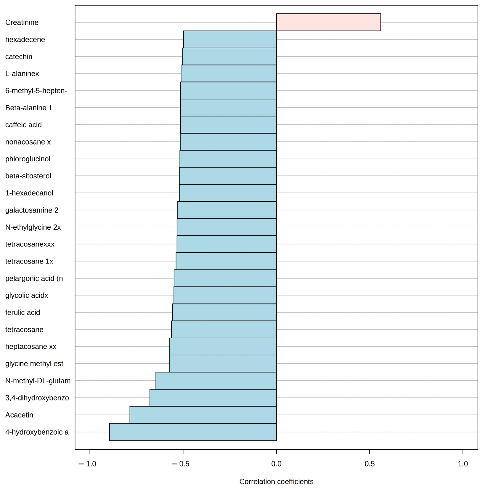

These selected outputs show how field ecology, environmental stress biology and molecular approaches have developed into questions about biological organisation and resilience.

## Selected peer-reviewed publications

::: {.publication-showcase}

Non-model ecotoxicogenomics resource

### De novo transcriptome assembly and annotation of the common freshwater amphipod (*Gammarus pulex*): a valuable resource for ecotoxicogenomics

<strong>Escobar-Sierra, C.</strong>, Hassan, S., Weichert, F. G., Aronsson, H., Lampert, K. P., Hollert, H., Backhaus, T., & Inostroza, P. A. (2025). <em>Scientific Data</em>, 12, 1502.

::: {.publication-visual}
{fig-alt="Workflow summarising raw-read processing, de novo transcriptome assembly, validation and annotation for the Gammarus pulex transcriptome resource."}
:::

Study visual: Fig. 2 from Escobar-Sierra et al. (2025), CC BY 4.0.

<strong>Why it matters.</strong> An open molecular resource designed to enable reproducible ecotoxicogenomics in a widely used non-model freshwater sentinel.

[DOI →](https://doi.org/10.1038/s41597-025-05872-2)

:::

::: {.publication-showcase}

Comparative multi-tissue fish transcriptomics

### Unraveling the molecular mechanisms of fish physiological response to freshwater salinization: A comparative multi-tissue transcriptomic study in a river polluted by potash mining

<strong>Escobar-Sierra, C.</strong>, Cañedo-Argüelles, M., Vinyoles, D., & Lampert, K. P. (2024). <em>Environmental Pollution</em>, 357, 124400.

::: {.publication-visual}
{fig-alt="Graphical abstract summarising comparative multi-tissue transcriptomic responses of fish to freshwater salinisation."}
:::

Study visual: graphical abstract from Escobar-Sierra et al. (2024), CC BY-NC.

<strong>Why it matters.</strong> Connected environmentally realistic exposure with tissue-specific and shared molecular response mechanisms across brain, gill and liver.

[DOI →](https://doi.org/10.1016/j.envpol.2024.124400)

:::

::: {.publication-showcase}

Field-based de novo transcriptomics

### Field application of de novo transcriptomic analysis to evaluate the effects of sublethal freshwater salinization on *Gasterosteus aculeatus* in urban streams

<strong>Escobar-Sierra, C.</strong> & Lampert, K. P. (2024). <em>PLOS ONE</em>, 19, e0298213.

::: {.publication-visual}
{fig-alt="Graphical abstract summarising field application of de novo transcriptomics to evaluate sublethal freshwater salinisation in wild fish."}
:::

Study visual: graphical abstract from the [doctoral thesis](https://kups.ub.uni-koeln.de/75069/), Chapter 1, CC BY-NC.

<strong>Why it matters.</strong> Demonstrated how de novo transcriptomics can recover mechanistic sublethal responses directly from wild fish under complex field conditions.

[DOI →](https://doi.org/10.1371/journal.pone.0298213)

:::

::: {.publication-showcase}

Multiple-stressor theory

### The Asymmetric Response Concept explains ecological consequences of multiple stressor exposure and release

Vos, M., Hering, D., Gessner, M. O., et al., <strong>Escobar-Sierra, C.</strong>, et al. (2023). <em>Science of the Total Environment</em>, 872, 162196.

<strong>Why it matters.</strong> Contributed to a broader conceptual framework for understanding why ecological response to stressor increase and release need not follow the same trajectory.

[DOI →](https://doi.org/10.1016/j.scitotenv.2023.162196)

:::

::: {.publication-showcase}

Ecology meets omics

### Metabolomics unravels grazing interactions under nutrient enrichment from aquaculture

<strong>Escobar-Sierra, C.</strong>, de Kock, W., Hasler-Sheetal, H., Holmer, M., Chatzigeorgiou, G., Tsapakis, M., & Apostolaki, E. T. (2023). <em>Diversity</em>, 15, 31.

::: {.publication-visual}
{fig-alt="Published Figure 5 showing the Pattern Hunter analysis for Paracentrotus lividus and the top 25 metabolite spectra bins associated with distance from aquaculture nutrient enrichment."}
:::

Study visual: Fig. 5 from Escobar-Sierra et al. (2023), CC BY 4.0.

<strong>Why it matters.</strong> An early integration of ecological experimentation with an omics approach, linking aquaculture-associated nutrient enrichment to community-level metabolic responses.

[DOI →](https://doi.org/10.3390/d15010031)

:::

## Software

### EchoGO

::: {.software-showcase}
{fig-alt="EchoGO logo." .software-logo}

**Escobar-Sierra, C.**, Langschied, F., Miller, A., & Inostroza, P. A.  
Open-source R framework for annotation-context-aware functional interpretation in non-model eco-omics.

[GitHub](https://github.com/miloes114/EchoGo) · [Latest release v0.1.4](https://github.com/miloes114/EchoGo/releases/tag/v0.1.4) · [Zenodo v0.1.4](https://doi.org/10.5281/zenodo.23158481)
:::

## Data resources

### *Gammarus pulex* transcriptome resource

An open molecular resource described in the *Scientific Data* article above. The article DOI is the stable entry point to its data-availability information.

[DOI](https://doi.org/10.1038/s41597-025-05872-2)

## Research compendia

### Holtemme Gammarus ecotoxicogenomics research compendium

A versioned reproducible research compendium integrating environmental chemistry, RNA-seq, functional interpretation, and network analysis.

[GitHub](https://github.com/miloes114/holtemme-gammarus-ecotoxicogenomics)

---

## Full publication record

For the complete publication list:

[Google Scholar](https://scholar.google.com/citations?user=MZuNEEoAAAAJ&hl=en) · [ORCID](https://orcid.org/0000-0001-9105-4378) · [ResearchGate](https://www.researchgate.net/profile/Camilo-Escobar-Sierra) · [Academic CV](https://camiloescobarsierra.com/miloes114-academic-cv/Camilo_Escobar_Sierra_Academic_CV.pdf)
