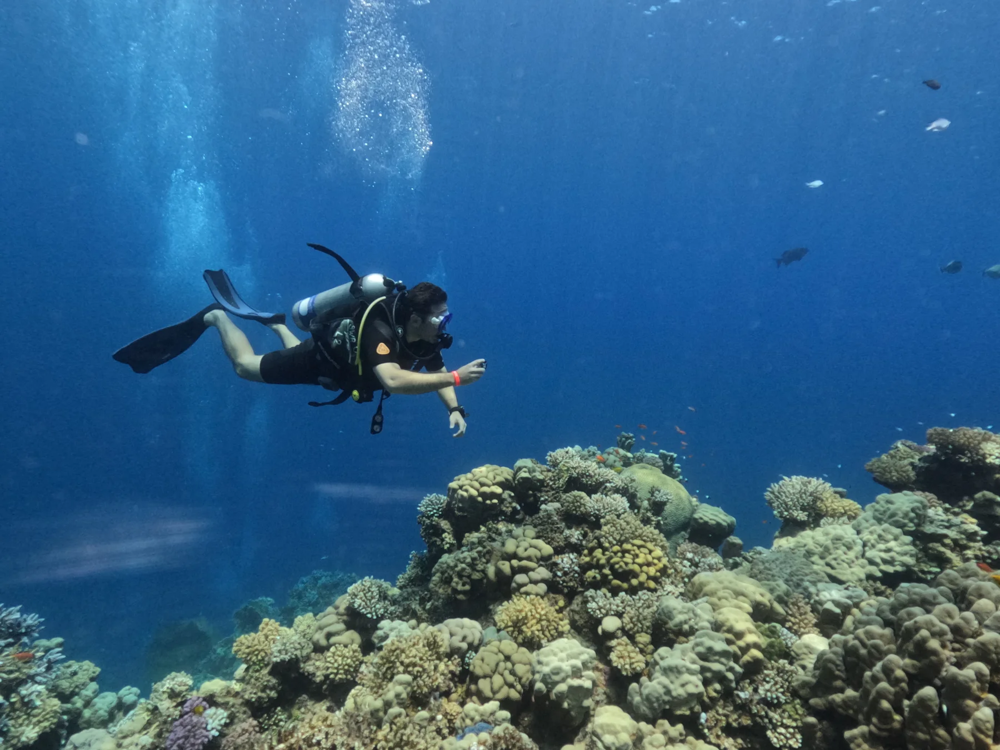

## Environmental Stress Systems Ecology

Living systems maintain their functions through interactions among biological components, from molecular networks and cellular processes to organisms, communities and ecosystems. Environmental stress can change these interactions and the resources needed to sustain them.

My research investigates **how biological organisation changes along environmental stress gradients**, how these changes influence system function, and under which conditions they support resilience or contribute to deterioration. I combine molecular ecology, environmental ecotoxicology, systems biology and computational approaches. Aquatic environments provide much of the empirical foundation for my work, while the underlying questions extend across biological systems and scales.

**My central question:** How does environmental stress reshape biological organisation across scales, and how do these changes influence the function and resilience of living systems?

::: {.photo-strip .research-photo-strip}
::: {.photo-strip-item .photo-strip-item--boat}
{fig-alt="River fieldwork from a small boat."}

Biodiversity assessment on the Cauca River, Colombia.

:::

::: {.photo-strip-item .photo-strip-item--stream}
{fig-alt="Field sampling with a net in an urban aquatic system."}

Electrofishing during biodiversity assessment in urban rivers of the Colombian Caribbean.

:::

::: {.photo-strip-item .photo-strip-item--reef}
{fig-alt="Scuba diving above a coral reef."}

Exploring coral reefs in Egypt.

:::
:::

## Environmental stress and living systems {#real-world-environmental-stress}

Natural environments expose biological systems to changing conditions, including chemical mixtures, salinisation, temperature shifts and other pressures that interact across space and time. Rivers and coastal ecosystems provide opportunities to observe these pressures under realistic conditions.

My work with wild fish and freshwater amphipods has linked environmental gradients with changes in gene activity and biological pathways. Field-based transcriptomics, tissue comparisons and environmental chemistry reveal how responses vary among organisms, tissues and sites. These observations help formulate hypotheses about the processes that allow biological systems to function under stress.

## Biological organisation and resilience {#biological-organisation-and-resilience}

Biological organisation describes **how components of a living system are connected, coordinated and arranged**. From a thermodynamic perspective, maintaining organised states requires ongoing exchanges of energy and matter. From a network perspective, we can investigate organisation through patterns of connectivity, modularity, redundancy and coordination among components. These complementary perspectives help us understand how living systems maintain and reorganise their functions.

Organisation, function and resilience describe related aspects of this process:

- **Organisation:** the structure and coordination of biological components and processes.
- **Function:** the activities and performance sustained by the system.
- **Resilience:** its capacity to maintain or recover essential functions under disturbance.

### The Hierarchical Stress Gradient Hypothesis (Hi-SGH)

I am developing **Hi-SGH** as a testable framework for how biological organisation responds to environmental stress. It proposes that compensatory responses may initially increase coordination among processes. As pressure intensifies, maintaining this organisation may become more demanding and vulnerable, eventually leading to reduced coordination and functional deterioration.

Hi-SGH draws on ecological stress theory, thermodynamic perspectives on living systems and network theory. It generates predictions about changes in organisation, compensation and potential thresholds that can be tested across different biological systems.

<figure class="research-concept-figure research-concept-figure--curve">
  <video class="research-animation" autoplay muted loop playsinline preload="metadata" poster="assets/images/research/hi-sgh-stress-gradient-still.webp" aria-label="Conceptual Hi-SGH animation showing a rise and subsequent decline in biological organisation alongside a separate health trajectory across an increasing chemical stress gradient.">
    <source src="assets/images/research/hi-sgh-stress-gradient.mp4" type="video/mp4">
  </video>
  
  <figcaption><strong>Hi-SGH: conceptual predictions.</strong> The animation illustrates a possible trajectory along increasing chemical stress. In TROPECO-OMICS, <em>Holobiont Multilayer Organisation</em> (HMO, blue) describes coordinated organisation across transcriptomic, proteomic, microbial and physiological layers; health (red) is evaluated separately. The curves illustrate testable relationships; their shapes and transition points remain empirical questions.</figcaption>
</figure>

## Measuring biological organisation {#integrative-eco-omics}

To study these questions, I combine measures of gene expression, proteins, microbial communities and physiological condition with environmental chemistry and ecological information. **Network analysis and integrative eco-omics** help quantify how biological processes relate to one another, which connections change, and how coordination varies along environmental gradients.

A fish and its associated microorganisms form one example of a **holobiont**: interacting host and microbial components whose responses can be studied together. The same research logic can be applied to other organisms, biological communities and ecological networks.

<figure class="research-concept-figure research-concept-figure--fish">
  <video class="research-animation" autoplay muted loop playsinline preload="metadata" poster="assets/images/research/reef-fish-holobiont-still.webp" aria-label="Animated reef fish illustrating RNA, protein and microbiome interactions around a host organism.">
    <source src="assets/images/research/reef-fish-holobiont.mp4" type="video/mp4">
  </video>
  
  <figcaption><strong>An integrated biological system.</strong> A reef fish illustrates how molecular processes and host-associated microorganisms can be studied together. The changing network patterns are conceptual and depict possible forms of biological reorganisation.</figcaption>
</figure>

In **TROPECO-OMICS**, I propose to operationalise Holobiont Multilayer Organisation (HMO) through within-layer network measures and agreement across molecular, microbial and physiological datasets. System condition is assessed separately through health and performance indicators. Network metrics make aspects of organisation measurable; they are complementary to the thermodynamic ideas that motivate the wider programme.

## From theory to ecological evidence

My research has grown from **field ecology and aquatic biodiversity assessment** into fish stress physiology, transcriptomics and environmental bioinformatics. Studies of freshwater salinisation and complex pollutant mixtures laid the empirical foundation for investigating how environmental responses are organised. Research with *Gammarus pulex* has extended these questions to freshwater invertebrates and environmental chemistry gradients.

I develop reproducible computational resources that preserve the connection between molecular results and their biological interpretation. [EchoGO](https://github.com/miloes114/EchoGo), described in [*MethodsX*](https://doi.org/10.1016/j.mex.2026.104222), supports traceable functional interpretation of transcriptomic data, especially for non-model organisms.

**TROPECO-OMICS** provides a proposed application of Hi-SGH to tropical freshwater fish holobionts, combining chemical exposure, molecular and microbial networks, physiological endpoints and independent health assessments. My broader interests also extend to coastal systems, including reef-associated organisms and the effects of environmental change on biodiversity and ecosystem functioning.

The long-term aim of **Environmental Stress Systems Ecology** is to develop and test transferable ways to connect environmental exposure, biological organisation, system function and ecological resilience.

[Explore research projects](projects.qmd) · [Selected publications](publications.qmd) · [Academic CV](https://camiloescobarsierra.com/miloes114-academic-cv/Camilo_Escobar_Sierra_Academic_CV.pdf)
