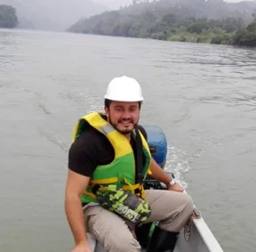
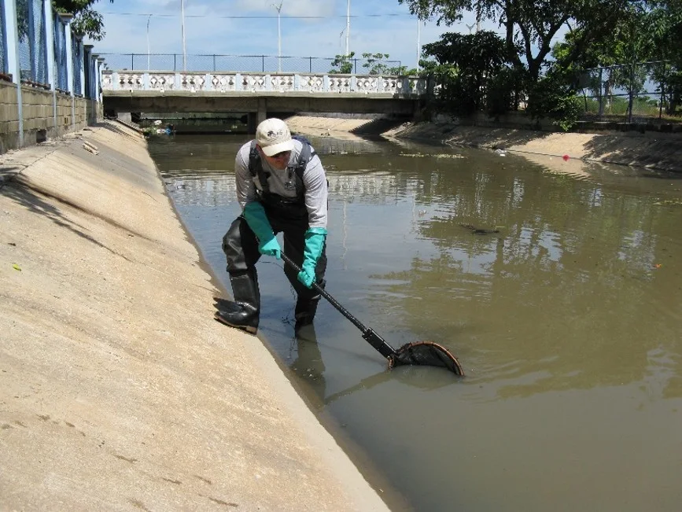
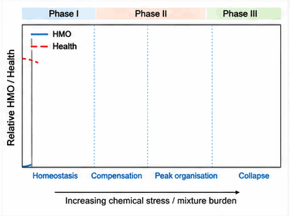
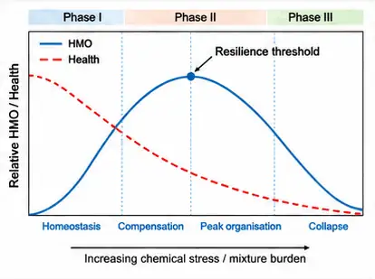
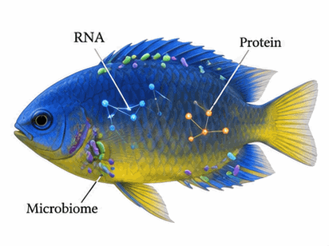
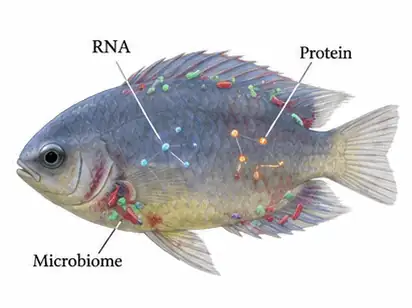

## Environmental Stress Systems Ecology

Living systems maintain their functions through interactions among biological components, from molecular networks and cellular processes to organisms, communities and ecosystems. Environmental stress can change these interactions and the resources needed to sustain them.

My research investigates **how biological organisation changes along environmental stress gradients**, how these changes influence system function, and under which conditions they support resilience or contribute to deterioration. I combine molecular ecology, environmental ecotoxicology, systems biology and computational approaches. Aquatic environments provide much of the empirical foundation for my work, while the underlying questions extend across biological systems and scales.

**My central question:** How does environmental stress reshape biological organisation across scales, and how do these changes influence the function and resilience of living systems?

::: {.photo-strip .research-photo-strip}
::: {.photo-strip-item .photo-strip-item--boat}
{fig-alt="River fieldwork from a small boat."}

Biodiversity assessment on the Cauca River, Colombia.

:::

::: {.photo-strip-item .photo-strip-item--stream}
{fig-alt="Field sampling with a net in an urban aquatic system."}

Electrofishing during biodiversity assessment in urban rivers of the Colombian Caribbean.

:::

::: {.photo-strip-item .photo-strip-item--reef}
{fig-alt="Scuba diving above a coral reef."}

Exploring coral reefs in Egypt.

:::
:::

## Environmental stress and living systems {#real-world-environmental-stress}

Natural environments expose biological systems to changing conditions, including chemical mixtures, salinisation, temperature shifts and other pressures that interact across space and time. Rivers and coastal ecosystems provide opportunities to observe these pressures under realistic conditions.

My work with wild fish and freshwater amphipods has linked environmental gradients with changes in gene activity and biological pathways. Field-based transcriptomics, tissue comparisons and environmental chemistry reveal how responses vary among organisms, tissues and sites. These observations help formulate hypotheses about the processes that allow biological systems to function under stress.

## Biological organisation and resilience {#biological-organisation-and-resilience}

Biological organisation describes **how components of a living system are connected, coordinated and arranged**. From a thermodynamic perspective, maintaining organised states requires ongoing exchanges of energy and matter. From a network perspective, we can investigate organisation through patterns of connectivity, modularity, redundancy and coordination among components. These complementary perspectives help us understand how living systems maintain and reorganise their functions.

Organisation, function and resilience describe related aspects of this process:

- **Organisation:** the structure and coordination of biological components and processes.
- **Function:** the activities and performance sustained by the system.
- **Resilience:** its capacity to maintain or recover essential functions under disturbance.

### The Hierarchical Stress Gradient Hypothesis (Hi-SGH)

I am developing **Hi-SGH** as a testable framework within this research programme. It proposes that compensatory responses may initially increase coordination among biological processes. As pressure intensifies, maintaining that coordination may require more resources and eventually become less effective, with consequences for system function and resilience.

Hi-SGH draws on ecological stress theory, thermodynamic perspectives on living systems and network theory. It generates predictions about changes in organisation, compensation and potential thresholds that can be tested across different biological systems.

<figure class="research-concept-figure research-concept-figure--curve">
  
  
  <button type="button" class="research-motion-toggle" data-play-label="Play animation" data-pause-label="Pause animation" hidden>Pause animation</button>
  <figcaption><strong>Hi-SGH: conceptual predictions.</strong> The blue HMO curve (Holobiont Multilayer Organisation) illustrates one possible quantitative measure of biological coordination, informed by network theory and thermodynamic perspectives on living systems. The red curve represents health as a separate dimension. Their shapes and potential transition points are hypotheses to be tested across biological systems.</figcaption>
</figure>

## Measuring biological organisation {#integrative-eco-omics}

To study these questions, I combine gene-expression data, protein measurements, microbial communities and physiology with environmental chemistry and ecological information. **Network analysis and integrative eco-omics** help reveal which processes act together, how their relationships change along environmental gradients and how these changes relate to system condition. At other biological scales, comparable questions can be explored through ecological interaction and community networks.

A fish and its associated microorganisms form one example of a **holobiont**: interacting host and microbial components whose responses can be studied together. The same research logic can be applied to other organisms, biological communities and ecological networks.

<figure class="research-concept-figure research-concept-figure--fish">
  
  
  <button type="button" class="research-motion-toggle" data-play-label="Play animation" data-pause-label="Pause animation" hidden>Pause animation</button>
  <figcaption><strong>An integrated biological system.</strong> This reef fish is an example of studying interacting molecular processes and host-associated microorganisms together. The animated networks illustrate possible patterns of organisation; the underlying research questions extend to communities and ecosystems.</figcaption>
</figure>

Across my research programme, I am developing ways to quantify organisation using network connectivity, modularity, redundancy and coordination within and among biological processes. These metrics offer practical ways to examine patterns suggested by network theory, while thermodynamic perspectives help frame how living systems maintain organised states through energy and matter exchange. Independent measures of physiological condition, performance and ecological functioning help relate these patterns to health and resilience.

## From theory to ecological evidence

My research has grown from **field ecology and aquatic biodiversity assessment** into fish stress physiology, transcriptomics and environmental bioinformatics. Studies of freshwater salinisation and complex pollutant mixtures laid the empirical foundation for investigating how environmental responses are organised. Research with *Gammarus pulex* has extended these questions to freshwater invertebrates and environmental chemistry gradients.

I develop reproducible computational resources that preserve the connection between molecular results and their biological interpretation. [EchoGO](https://github.com/miloes114/EchoGo), described in [*MethodsX*](https://doi.org/10.1016/j.mex.2026.104222), supports traceable functional interpretation of transcriptomic data, especially for non-model organisms.

This programme is already developing through my published studies, ongoing analyses of environmental stress responses, reproducible computational tools and interdisciplinary research proposals. These activities connect field observations with quantitative approaches to biological organisation and system condition. I am extending these questions across freshwater and marine settings, including tropical aquatic and reef-associated systems, to examine how general principles vary with ecological context and biological scale.

The long-term aim of **Environmental Stress Systems Ecology** is to develop and test transferable ways to connect environmental exposure, biological organisation, system function and ecological resilience.

[Explore research projects](projects.qmd) · [Selected publications](publications.qmd) · [Academic CV](https://camiloescobarsierra.com/miloes114-academic-cv/Camilo_Escobar_Sierra_Academic_CV.pdf)

